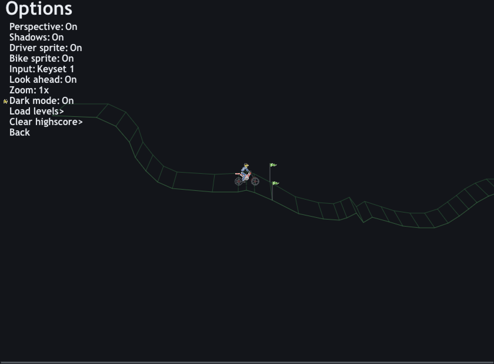
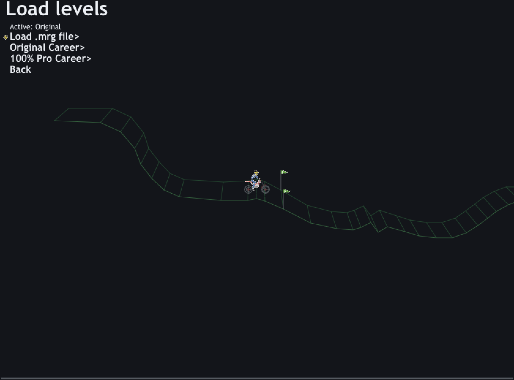
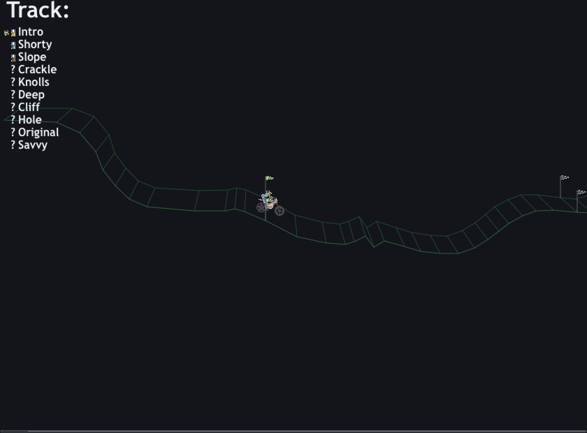
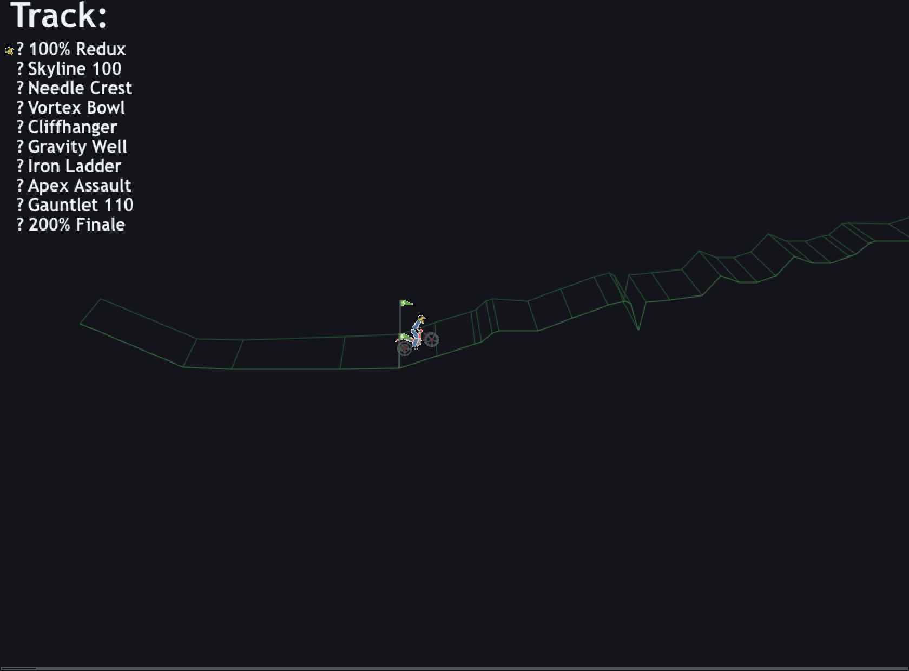
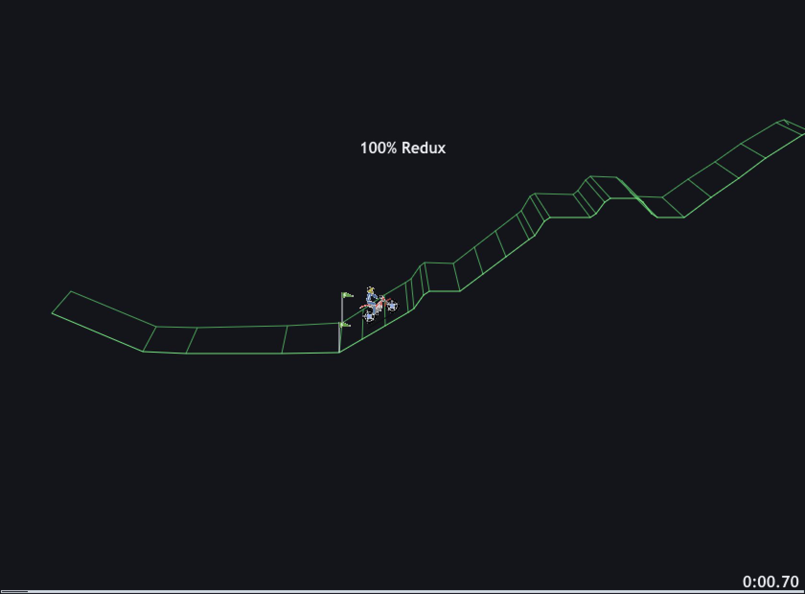

# Gravity Defied Web

**Gravity Defied** is a legendary mototrial racing mobile game. It was originally developed by Codebrew Software in 2004 for J2ME platform.

This fork extends the TypeScript/Canvas browser port with **Dark Mode**, a **Native Level Loader** (supporting disk `.mrg` files), an **Alternative 100%-Inspired Pro Career**, and an **Incomplete (`?`) & Top Medal Track System** (all tracks, levels, and bikes playable from the start).

## Showcase

| Dark Mode (`Options`) | Native Level Loader |
|---|---|
|  |  |

| Incomplete (`?`) & Top Medals | 100% Pro Career (`Pro` Tracks) |
|---|---|
|  |  |

| `100% Redux` Gameplay (Dark Mode) |
|---|
|  |

## What's New in This Fork

- **Dark Mode (`Options > Dark mode`)**: `Auto` (follows system `prefers-color-scheme`), `On`, or `Off`, theming the canvas renderer, dimmed menu backdrop, HUD, page shell, and touch controls without FOUC.
- **Native Level Loader (`Play Menu / Options > Load levels`)**: Switch between **Original Career**, **100% Pro Career**, or load/reload custom `.mrg` track archives directly from disk.
- **100% Pro Career (`src/assets/alt-career.mrg`)**: 30 new `100%`-inspired technical trials tracks across Easy, Medium, and Pro tiers (`100% Redux`, `Skyline 100`, `200% Finale`, etc.), physics-verified across `GamePhysics`.
- **No Track Locks (`?` & Top Medals)**: All levels, tracks, and leagues (`100cc`–`325cc`) are unlocked from the start. Incomplete tracks display `?`; completed tracks display your top earned medal (Gold, Silver, or Bronze).

---

🎮 **Original online version:**  
https://yurkagon.github.io/gravity-defied-web/


## Controls

On a phone or tablet the game shows on-screen buttons: the arrows ride the bike and move through the menus, `OK` selects, and `Menu` / `Back` pauses or goes back.

With a keyboard:

| Key | Action |
|----|----|
| ↑ / ↓ | Accelerate / Brake |
| ← / → | Lean rider backward / forward |
| Enter | Select menu item |
| Escape | Pause game |

## Progress

Unlocked tracks and leagues, options and best times are stored in your browser (`localStorage`). The game saves them every time a track is finished and when the page is closed. Clearing the site data resets the game.

## About

This project is a browser-based port of the classic Gravity Defied game. It's built using:
- **TypeScript** - for type-safe code
- **JavaScript** - for runtime execution
- **Vite** - for fast development and building
- **HTML5 Canvas** - for rendering the game graphics

The project is based on the C++ & SDL2 port: [gravity_defied_cpp](https://github.com/rgimad/gravity_defied_cpp)

## Display

On a large screen the bike and the track can look small. `Options > Zoom` enlarges the game graphics from 1x to 4x. The choice is saved with the other options.

## Disclaimer

**This Project is not associated with Codebrew Software in any fashion. All rights to the original Gravity Defied, it's name, logotype, brand and all that stuff belong to Codebrew Software.**

## Getting Started

### Prerequisites

- Node.js (v18 or higher recommended)
- npm or yarn

### Installation

```bash
npm install
```

### Development

Start the development server:

```bash
npm run dev
```

The game will be available at `http://localhost:3000`

### Build

Build the project for production:

```bash
npm run build
```

The built files will be in the `dist` directory.

### Preview

Preview the production build:

```bash
npm preview
```

## Project Structure

```
gravity-defied-web/
├── src/              # Source code
│   ├── app.ts       # Main application entry point
│   ├── main.ts      # Application initialization
│   └── ...          # Game logic, canvas rendering, physics, etc.
├── index.html       # HTML entry point
├── vite.config.ts   # Vite configuration
└── package.json     # Dependencies and scripts
```

## Technologies

- **TypeScript** - Type-safe JavaScript
- **Vite** - Next generation frontend tooling
- **HTML5 Canvas** - 2D graphics rendering
- **ESLint** - Code linting

## Topics

`gravity-defied` `game` `mototrial` `racing` `browser-game` `typescript` `vite` `canvas` `web-game` `retro-game` `j2me-port`

## Cheats and modding

The built-in cheat name, save editing and modding notes are in [HACKING.md](HACKING.md).

## License

This project is licensed under the GNU General Public License v2.0 (GPL-2.0). See [LICENSE.md](LICENSE.md) for the full license text.

## Contributing

Contributions are welcome! Feel free to open issues or submit pull requests.

## Contributors

<a href="https://github.com/yurkagon/gravity-defied-web/graphs/contributors">
  
</a>
